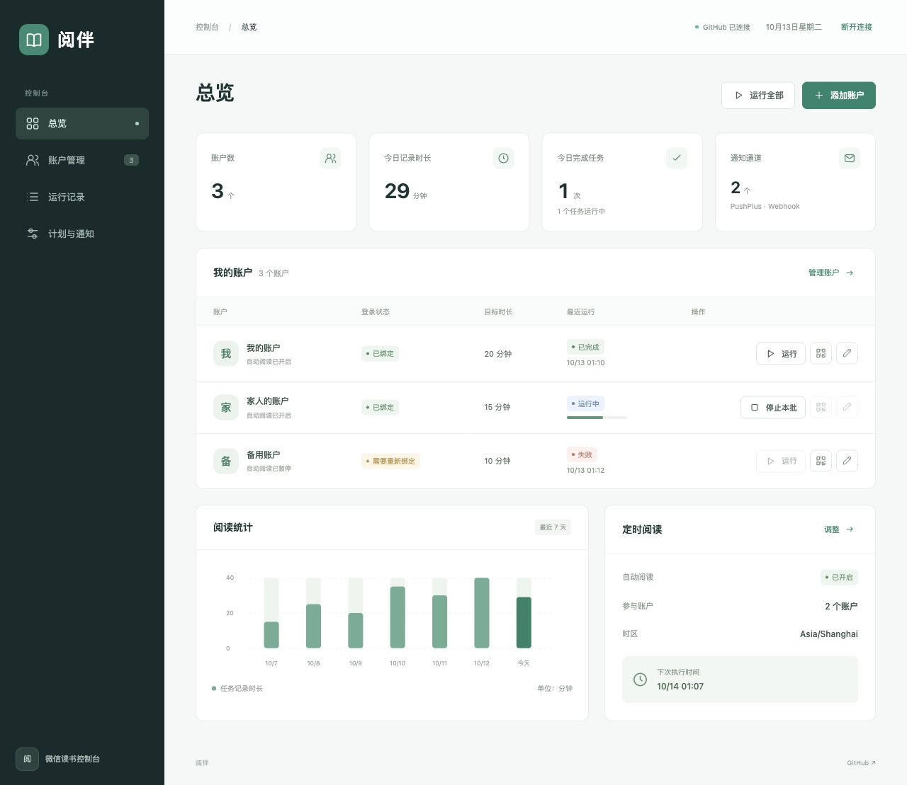
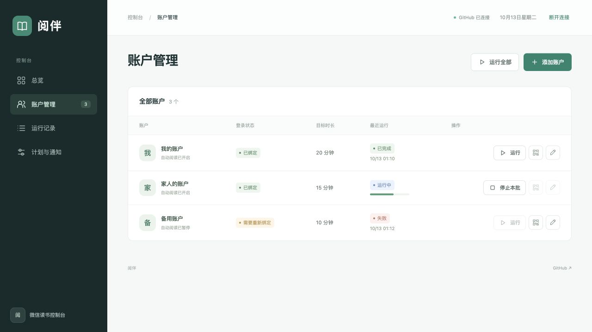
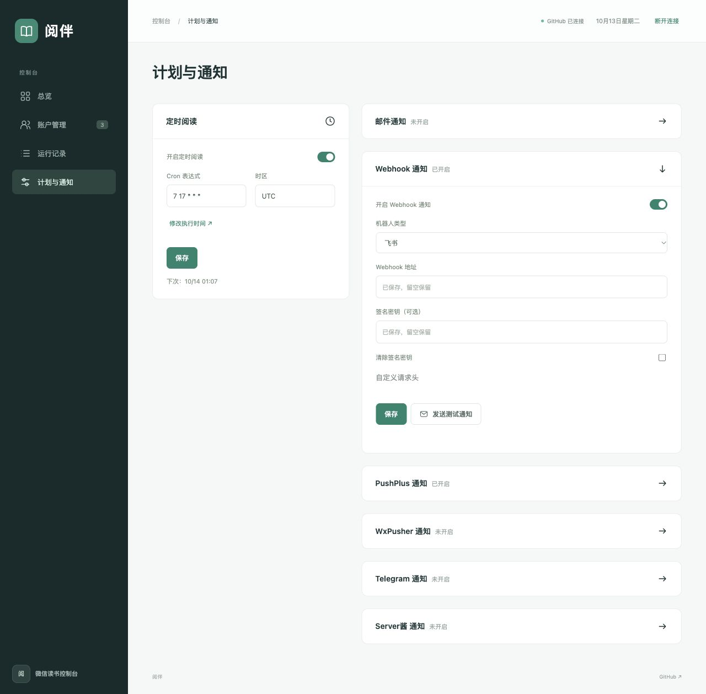
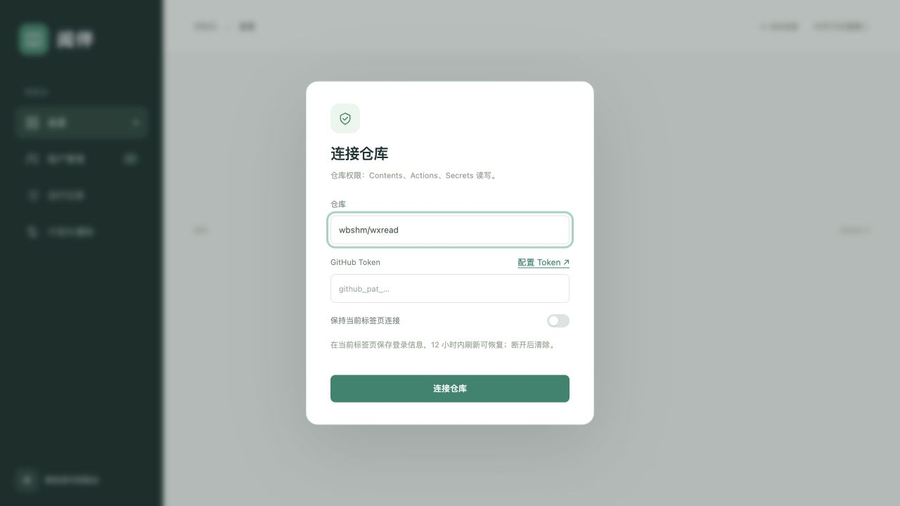

# 阅伴 · GitHub Pages 微信读书多账户控制台

**[打开 Web 管理后台 →](https://wbshm.github.io/wxread/)** · [配置 GitHub Token](https://github.com/settings/personal-access-tokens) · [查看 Actions 运行记录](https://github.com/wbshm/wxread/actions)

**界面运行在 GitHub Pages，扫码、阅读和发邮件由 GitHub Actions 执行。** 不需要部署服务器或启动 Docker。

Pages 只托管 `pages/` 中的 HTML、CSS 和 JavaScript。页面通过 GitHub API 触发 Actions；Actions 在临时浏览器中生成微信读书的真实二维码，扫码成功后保存账户。阅读任务最多并行 4 个账户，每个账户独立 Cookie、目标时长和收件邮箱。

## 当前 Web 版功能

- **多账户管理**：微信扫码绑定、cURL 导入、重新绑定、独立目标时长和通知邮箱。
- **阅读总览与任务记录**：查看账户状态、最近七天记录、任务进度、成功或失败结果；支持手动运行和停止本批任务。
- **计划与多渠道通知**：定时阅读开关，邮件、PushPlus、WxPusher、Telegram、Server酱，以及企业微信、飞书、钉钉和通用 JSON Webhook；渠道可同时启用、分别测试。
- **连接恢复与加密状态**：可选保持当前标签页连接，12 小时内刷新恢复；网络波动自动重试，账户凭据与通知密钥加密保存。

## 快速使用

1. 打开上方的 **Web 管理后台**。这里的链接进入 `wbshm/wxread` 已发布的页面；使用 Fork 时，请改用你自己的 Pages 地址。
2. 在连接窗口填写仓库和自己的 GitHub Token。Token 输入框右侧的 **「配置 Token ↗」** 会在新标签页打开 GitHub 的配置页；选择此仓库并按下方权限表授权。
3. 连接后点击 **「添加账户」→「生成扫码二维码」**，等待 Actions 准备完成，再使用微信扫码并在手机上确认。
4. 在 **「计划与通知」** 选择通知渠道，发送测试通知并保存；然后可手动运行账户，或等待定时任务。

GitHub 插件的连接授权与 Web 后台的 Token 是两套独立登录状态，插件授权不会自动传给公开的 Pages 页面。已经连接的 Web 标签页无需重复填写 Token；希望刷新后恢复时，可在登录时勾选「保持当前标签页连接」。

## Web 界面截图

以下截图使用当前 `pages/` 界面和演示账户拍摄；账户、邮箱、阅读统计及通知开启状态均为演示数据，不包含真实 Token、Cookie 或机器人地址。

### 阅读总览



<details>
<summary>查看账户管理、通知设置与连接窗口</summary>

### 多账户管理



### 计划与通知



### 连接仓库与 Token 配置入口



</details>

## 发布到 GitHub Pages

1. 将本次代码推送到你的仓库默认分支。
2. 仓库 **Settings → Pages → Build and deployment → Source** 选择 **GitHub Actions**。
3. 在 **Actions** 中运行 **Publish GitHub Pages**。Fork 后还需要启用 Actions。
4. 发布成功后打开工作流输出的网址，例如 `https://你的用户名.github.io/wxread/`。

页面地址取决于仓库所有者和仓库名，不使用本机 `127.0.0.1` 地址。Pages 工作流只上传 `pages/`，不会把 Python 文件、数据库、`.env` 或本地登录信息发布出去。

## 第一次连接仓库

页面点击「连接仓库」，填写 `owner/repository` 和自己的 **fine-grained personal access token**。输入框旁的「配置 Token ↗」会打开 [GitHub Token 配置页](https://github.com/settings/personal-access-tokens)；点击 **Generate new token** 创建 Token。[GitHub 官方创建说明](https://docs.github.com/en/authentication/keeping-your-account-and-data-secure/managing-your-personal-access-tokens#creating-a-fine-grained-personal-access-token)。

创建 Token 时只选择这个仓库，授予以下 Repository permissions：

| 权限 | 级别 | 用途 |
| --- | --- | --- |
| Contents | Read and write | 初始化、读取和更新加密状态分支 |
| Actions | Read and write | 触发扫码/阅读、查看和取消工作流 |
| Secrets | Read and write | 第一次初始化加密密钥 Secret |
| Metadata | Read | GitHub 默认授予 |

可从 [GitHub Token 设置](https://github.com/settings/personal-access-tokens)创建。使用自己的仓库；控制台是给仓库管理者使用的，不是向访客开放的多租户服务。

首次连接会创建：

- 仓库 Secret **`WXREAD_CONTROL_KEY`**：用于解密账户状态和页面指令的私钥。
- 分支 **`wxread-state`**：存储公钥、加密账户配置、加密任务记录和加密扫码结果。

默认仅在页面内存中保留 Token，刷新后需要重新连接。登录时可自行勾选「保持当前标签页连接」，将 Token 和页面的临时解密密钥保存在 `sessionStorage`，12 小时内在同一标签页刷新可以自动恢复；不会写入 `localStorage` 或仓库。通常随标签页关闭清除，浏览器恢复标签页时可能恢复会话；主动点击「断开连接」会立即清除。共享设备请勿勾选，浏览器禁止会话存储时会退回内存模式并提示。

网络波动、GitHub 临时故障和 API 限流会自动重试或等待恢复，保留当前连接；仅 GitHub 返回 Token 无效的 401 时清除登录信息。后台标签页暂停总览轮询，返回页面或网络恢复时继续；运行中的页面会续订 Actions 的加密状态订阅。权限不足会显示具体提示。[GitHub 限流与恢复规则](https://docs.github.com/en/rest/using-the-rest-api/rate-limits-for-the-rest-api)。本机 `127.0.0.1` 页面与 GitHub Pages 是两个独立来源；日常使用请打开已发布的 Pages 地址。

仓库名称可以记住。已经存在的密钥不会在正常重新连接时重新生成。保留 `WXREAD_CONTROL_KEY`，删除或替换它会使已保存的账户状态无法解密。

## 扫码绑定多个账户

1. 连接完成后，点击「添加账户」。
2. 填写备注、每次目标时长，以及可选的独立通知邮箱。
3. 点击「生成扫码二维码」，等待 Actions 启动和准备浏览器，通常需要数十秒，也可能因 GitHub 排队更久。
4. 使用微信扫一扫，在手机上确认登录。页面显示绑定成功后即可关闭扫码窗口。
5. 重复操作即可绑定多个账户。

每次使用独立浏览器会话。重复绑定同一账户会更新登录信息，保留目标、邮箱和启用状态；「重新绑定」必须扫描原账户。

二维码有效期由微信读书官网决定，失效后会在同一个 Actions 任务中自动更新，页面同步显示新码，无需重新等待任务和浏览器启动。本次扫码窗口最多保持六分钟，请扫描页面当前显示的二维码。扫码窗口不支持刷新后恢复，请在扫码完成前保持页面打开。官网额外验证、网络问题或登录布局变化时，可以通过页面导入 cURL。

扫码和配置操作会等待 Actions 执行，不会像常驻服务器一样立即响应。扫码复用 Ubuntu 24.04 运行器自带的 Chrome，不再每次下载 Chromium。每个扫码会话独立运行，不会占住配置操作的串行队列；阅读工作流与它分开运行。工作流保留了原有的 `AutoRead` 环境；如果该环境要求审批，请在 GitHub Actions 中批准运行后继续。

## 定时阅读和运行记录

默认时间为 **北京时间每天 01:07**，GitHub 的 Cron 为 UTC `7 17 * * *`。可在页面「计划与通知」启停自动计划；手动运行仍可使用。

改变时间请编辑 `.github/workflows/deploy.yml` 的 `schedule`，例如：

```yaml
on:
  schedule:
    - cron: '30 0 * * *'  # 北京时间每天 08:30
```

GitHub 定时工作流可能延迟，长期无仓库活动时还可能停用，不能保证精确到分钟。[官方 schedule 说明](https://docs.github.com/en/actions/reference/workflows-and-actions/events-that-trigger-workflows#schedule)。

「运行全部」执行所有启用账户，也可以单独运行一个账户。一个账户失败不会阻止其余账户；登录失效后标记为需要重新绑定。点击「停止本批」会取消该 Actions 阅读工作流，包含它同时执行的所有账户。

刷新后的 Cookie 会写回加密状态，下一次工作流自动读取，不需要人工回写 Secrets。进度最多约每分钟同步一次；取消工作流时展示最后保存的进度。页面显示最近 100 条记录，加密状态保留最近 1000 条用于统计。

时长由脚本按成功阅读请求计算，不是从微信读书排行榜拉取的官方统计。运行状态和通知依赖第三方接口及 GitHub Actions 的可用性。

## 消息通知

页面「计划与通知」支持 **邮件、PushPlus、WxPusher、Telegram、Server酱、Webhook**。点击渠道标题展开设置，每个渠道都有独立开关、保存和测试按钮。可以同时开启多个渠道：所有开启的渠道分别发送每个账户的完成或失败结果；一个渠道失败不阻止其他渠道，运行记录会标出未送达的渠道。

已有的 `PUSH_METHOD` 与通知 Secrets 会在旧加密状态升级时自动导入，已保存的页面设置优先，后续环境变量不会覆盖页面配置。未使用 Pages 的 CLI 也继续兼容原有环境变量，`PUSH_METHOD` 可以用英文逗号分隔多个渠道，例如 `email,pushplus,webhook`。

| 渠道 | 页面填写内容 | 原有环境变量 / Secrets |
| --- | --- | --- |
| PushPlus | Token | `PUSHPLUS_TOKEN` |
| WxPusher | 极简推送 SPT | `WXPUSHER_SPT` |
| Telegram | Bot Token 和 Chat ID | `TELEGRAM_BOT_TOKEN`、`TELEGRAM_CHAT_ID` |
| Server酱 | SendKey，支持 SCT 和 sctp 格式 | `SERVERCHAN_SPT` |
| Webhook | 类型、HTTPS 地址，可选签名密钥和请求头 | `WEBHOOK_URL`、`WEBHOOK_SECRET`、`WEBHOOK_HEADERS`；`WEBHOOK_TYPE` 使用 Repository Variable |

已保存的通知 Token、签名密钥、Webhook 地址和请求头都加密存储，页面只显示是否已保存，不返回原值。输入框留空时保留旧值；Webhook 的签名密钥和自定义请求头可使用对应的清除选项移除。测试会使用表单当前填写的配置，不自动保存。

### Webhook 群机器人

1. 在企业微信、飞书或钉钉的群聊里添加自定义机器人，复制其 Webhook 地址。
2. 在控制台展开「Webhook 通知」，选择对应机器人类型，粘贴地址。
3. 飞书、钉钉如果启用了签名校验，填写机器人的签名密钥；两种平台会使用各自的签名协议。企业微信无需额外签名密钥。
4. 如机器人使用关键词验证，可配置「微信读书」，通知标题会包含该关键词。
5. 点击「发送测试通知」，确认群里收到消息，然后开启并保存。

三种机器人会分别使用平台要求的文本消息格式。响应中的业务错误码也会检查，HTTP 200 本身不代表机器人接受了消息。服务接受测试请求后仍应在接收端确认，部分通知服务异步投递消息。机器人配置参见 [企业微信文档](https://developer.work.weixin.qq.com/document/path/99110)、[飞书文档](https://open.feishu.cn/document/client-docs/bot-v3/add-custom-bot)、[钉钉文档](https://open.dingtalk.com/document/robots/customize-robot-security-settings)。

自建服务可选择「通用 JSON Webhook」，以 HTTP POST 接收以下结构；自定义认证可以在可选请求头 JSON 中填写。请求超时或非 2xx 状态会视为发送失败，不跟随重定向。

```json
{
  "event": "wxread.reading.completed",
  "title": "微信读书 · 任务完成",
  "content": "账户和阅读结果摘要",
  "success": true,
  "timestamp": "ISO 8601 时间",
  "data": {"account_id": "账户标识", "account_name": "账户备注", "run_id": "任务标识", "status": "success", "completed": 40, "target": 40}
}
```

失败事件为 `wxread.reading.failed`，测试事件为 `wxread.test`。Webhook 不包含 Cookie、SMTP 授权码或 GitHub Token。手动停止任务不发结果通知。

### 邮件发送

- **只接收 Actions 运行结果提醒**：在 [GitHub 通知设置](https://github.com/settings/notifications)开启 Actions 的 Email 通知。[官方说明](https://docs.github.com/en/subscriptions-and-notifications/how-tos/managing-github-actions-notifications)。
- **接收各账户的阅读结果邮件**：在页面「计划与通知」配置 SMTP 服务器、端口、加密方式、用户名、授权码、发件邮箱和默认收件邮箱。邮件由 Actions 通过你配置的邮箱服务发送。

「发送测试邮件」会触发 Actions，用表单中填写的配置发送，不会自动保存。保存时授权码留空代表保留原授权码。可为账户设置独立邮箱，留空则使用默认收件邮箱。默认地址支持英文逗号分隔多个收件人。

SMTP 授权码加密保存，页面读取设置时只返回「是否已保存授权码」，不会返回原值。任务成功或失败均可通知，手动停止不发送邮件。

## 加密和数据范围

账户 Cookie、通知 Token、Webhook 地址、签名密钥、请求头、SMTP 授权码、邮箱、备注和运行记录均加密后写入状态分支。页面指令使用仓库公钥加密；二维码及页面状态再使用当前浏览器的临时公钥加密，只有发起请求的页面能读取。

公开 Pages 和公开仓库中可以看见页面代码、公钥、密文和工作流元数据，无法直接看到 Cookie 或邮件授权码。Token、私钥和 Cookie 不写入工作流输入或明文日志。状态分支的 Git 历史会保留旧密文；保护仓库访问权限和加密密钥。拥有仓库 Actions/代码管理权限的人应被视为可信管理者。

代码使用本地随页面发布的 libsodium，不从第三方脚本 CDN 加载加密代码。浏览器只需要访问 GitHub API；微信读书登录由 Actions 的 Chromium 访问。

## 兼容原有账户配置

如果已经设置了仓库 Secret `WXREAD_CURL_BASH` 或 `WXREAD_ACCOUNTS_JSON`，首次创建加密状态时会导入。

多账户 JSON 示例：

```json
[
  {"name":"我的账户","curl":"完整的微信读书 read 请求 cURL","read_num":40,"email":"reader1@example.com"},
  {"name":"家人","cookies":{"wr_vid":"占位账户ID","wr_skey":"占位登录值"},"read_num":20,"email":"reader2@example.com"}
]
```

使用完整有效的 Cookie；示例占位值不能登录。`read_num` 每次 30 秒。页面导入只解析 cURL 文本，不执行命令。

未初始化 Pages 控制台时，原有定时脚本仍可从这些 Secrets 运行。初始化后，加密状态成为主要配置，旧 Secret 不再覆盖页面设置。原有 PushPlus、WxPusher、Telegram、ServerChan 环境变量通知继续兼容。

## 文件和验证

| 文件 | 用途 |
| --- | --- |
| `pages/` | GitHub Pages 静态界面 |
| `.github/workflows/pages.yml` | 发布页面 |
| `.github/workflows/control.yml` | 扫码、设置和测试邮件 |
| `.github/workflows/deploy.yml` | 定时或手动阅读 |
| `github_worker.py` | Actions 执行业务操作 |
| `github_state.py` | 加密状态和 GitHub API |
| `notifications.py` | 原有通知渠道、多渠道发送、Webhook 格式与签名 |
| `requirements-actions.txt` | Actions 专用依赖 |

```bash
pip install -r requirements.txt
python -m unittest discover -s tests -v
node tests/test_github_client.cjs
node tests/test_github_session.cjs
node tests/test_pages_polling.cjs
```

浏览器预览静态界面可用任意静态文件服务器。生产使用 GitHub Pages，不需要运行 `web.py`、`scheduler.py` 或 Docker。
